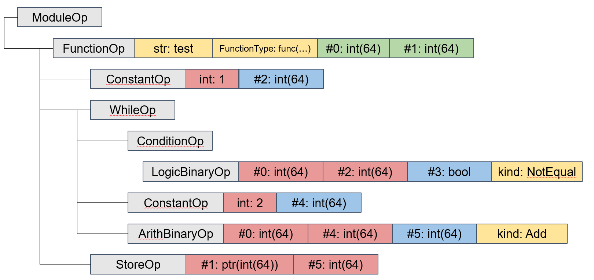
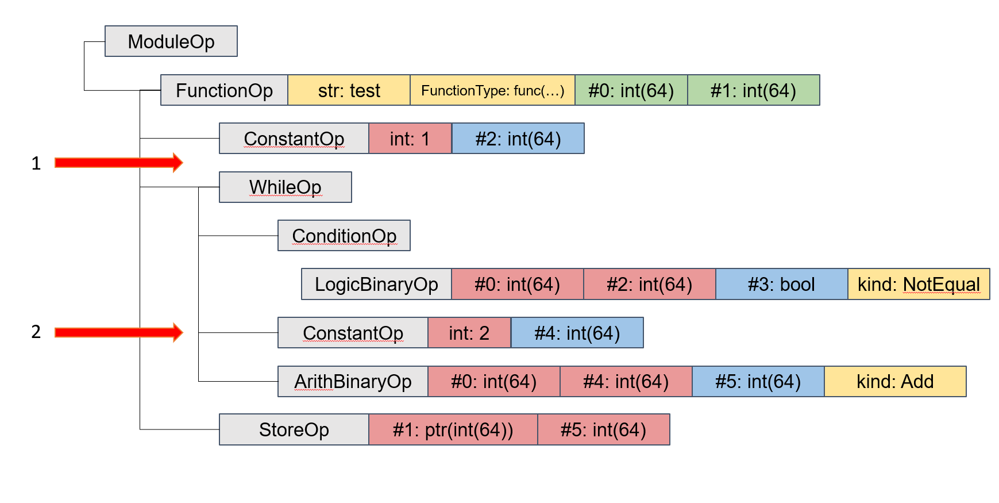
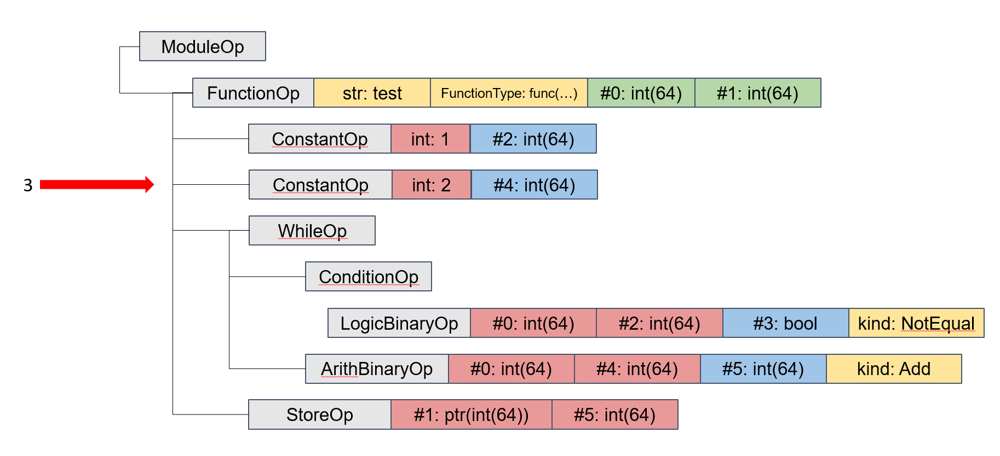

# Построение и изменение дерева операций

Для задач оптимизирующего анализатора требовалось реализовать инструмент
для работы с деревом операций, поддерживающий следующие операции:

- построение дерева операций;
- изменение дерева операций:
- вставка или удаление узла из дерева;
- клонирование конкретного узла дерева;
- замена конкретного узла дерева на другой;
- изменение конкретного узла дерева.

Исходя из перечисленных потребностей, были реализованы инструменты
Builder и OptBuilder с соответствующим функционалом.

Вышеупомянутый базовый класс Builder имеет следующее объявление:

```cpp
class Builder {
    using InsertPoint = Operation::Body::iterator;
    
    Operation::Ptr currentOp;
    InsertPoint insertPoint;

    Builder(const Operation::Ptr &currentOp, const InsertPoint &insertPoint)
        : currentOp(currentOp), insertPoint(insertPoint){};

public:
    Builder() = default;
    Builder(const Builder &) = default;
    Builder(Builder &&) = default;
    virtual ~Builder() = default;

    static Builder before(const Operation::Ptr &op);
    static Builder after(const Operation::Ptr &op);
    static Builder atBodyBegin(const Operation::Ptr &op);
    static Builder atBodyEnd(const Operation::Ptr &op);

    void setInsertPointBefore(const Operation::Ptr &op);
    void setInsertPointAfter(const Operation::Ptr &op);
    void setInsertPointAtBodyBegin(const Operation::Ptr &op);
    void setInsertPointAtBodyEnd(const Operation::Ptr &op);

    virtual void insert(const Operation::Ptr &op);
};
```

Здесь содержится:

- указатель на текущую операцию **currentOp**, над которой произошло
  или будет происходить изменение;
- итератор **insertPoint** – место, куда будет вставлена следующая
  операция при вызове метода вставки операций insert;
- методы создания билдера before, after, atBodyBegin, atBodyEnd до,
  после, в начале тела или в конце тела очередной операции
  соответственно;
- методы установки итератора до, после, в начале тела или в конце
  тела очередной операции;
- виртуальный метод **insert** для вставки операции в точку
  insertPoint.

Также реализован дополнительный класс OptBuilder с механизмом замены,
удаления и обновления заданной операции. Его объявление выглядит так:

```cpp
class OptBuilder : public Builder {
public:
    explicit OptBuilder(const Notifier &notifier) : Builder(), notifier(notifier){};

    OptBuilder(const OptBuilder &) = delete;
    OptBuilder(OptBuilder &&) = default;
    ~OptBuilder() override = default;

    void insert(const Operation::Ptr &op) override;
    Operation::Ptr clone(const Operation::Ptr &op);
    void erase(const Operation::Ptr &op);
    
    void update(const Operation::Ptr &op, 
               const std::function<void()> &actor = {});
    
    void replace(const Operation::Ptr &op, const Operation::Ptr &newOp);
    void replace(const Value::Ptr &value, const Value::Ptr &newValue);

private:
    const Notifier &notifier;
};
```

Класс содержит член notifier, задачей которого является уведомление
пользователя об изменении дерева операций. На каждой вызов метода erase,
insert, update или replace срабатывает функция обратного вызова
(callback), печатающая информацию об имени операции и преобразования,
которое было над ней выполнено, в соответствующий поток вывода.

## Пример изменения дерева операции

Реализованный механизм изменения дерева операций универсален, и с
помощью вызова комбинации вышеописанных методов можно совершать
нетривиальные преобразования. Разберем пример, в котором требуется
вынести операцию за тело ее родительской операции, который может быть
использован в реализации оптимизации LICM.

Исходное дерево:



Здесь серыми блоками обозначены операции, желтыми – их атрибуты,
зелеными – внутренние значения операции, красным – операнды, синим –
результаты операции. Имеется простейший цикл while, в котором находится
операция ConstantOp, объявляющая целочисленную 64-битную константу и
инициализирующая ее значением 2. Эта операция может быть вынесена за
тело цикла как инвариант. Теперь покажем, как при помощи инструментов
класса OptBuilder можно совершить вынос операции перед операцией цикла
WhileOp.

Исходное дерево с позициями вставки/удаления:



Проведем следующие изменения с исходным деревом:

- Помещаем точку вставки в позицию 1 (перед циклом), вызвав
  метод **setInsertPointBefore**;

- Клонируем операцию, обозначенную указателем 2, с помощью
  метода **clone** (на данном этапе она не прикреплена к дереву);

- Заменяем операцию 2 на склонированную операцию методом **replace**,
  тем самым удаляя исходную операцию 2. Вставка будет осуществлена в
  позицию, которую мы выставили в первом пункте, то есть в позицию 1.

На выходе имеем дерево, где в позицию 3 «поднята» целевая
операция ConstantOp.

Финальное дерево:



[_Назад_](README.md)
