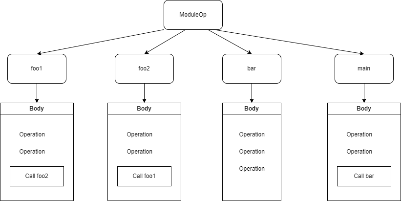

# Удаление неиспользуемых функций

Удаление неиспользуемых функций -- оптимизация в компиляторах,
уменьшающая количество исходного кода, путем удаления неиспользуемых
функций в коде.

Оптимизация разбивается на три стадии:

1.  Обход дерева операций и построение ориентированного графа вызовов D
    = (V, E), где

    a.  V -- множество вершин, значения которых однозначно соотносятся с
        идентификаторами функций,

    b.  E -- множество упорядоченных пар вершин u, v, принадлежащих
        множеству V, представляет собой отношение \<функция, вызываемая
        функция\>.

2.  Анализ графа D. Построение списка уникальных вершин $V_{u}$TODO,
    относящихся к определенной компоненте связанности.

3.  Удаление узлов дерева, которых нет в списке.

Рассмотрим каждую стадию подробнее.

## 1. Построение графа вызовов.

Для построения графа необходимо выполнить обход по всему дереву операций
и составить множество упорядоченных ребер E. В нашем дереве корневым
узлом является ModuleOp, поэтому с него и начинаем обход дерева. Для
каждого узла мы просматриваем его потомков и ищем среди них операции
вызова функций, и добавляем ребра в граф вызовов.

В данном дереве присутствуют 4 функции: foo1, foo2, bar, main. Как
результат этой стадии получим следующий список ребер

| Функция | Вызываемая функция |
|:-------:|:------------------:|
|  foo1   |        foo2        |
|  foo2   |        foo1        |
|  main   |        bar         |

Отметим несколько свойств этого графа вызовов:

- Граф может иметь несколько компонент связанности (в данном примере две
  компоненты связанности: граф на вершинах foo1 и foo2; граф на вершинах
  main и bar). На следующей стадии мы будем выделать вершины, которые
  будут относится к компоненте связанности с функцией main.

- Граф может иметь циклы (в данном примере ребра \<foo1, foo2\> и
  \<foo2, foo1\> образуют цикл).

## 2. Анализ графа D. Построение списка уникальных вершин.

В языке четко определена точка входа в программу -- функция **main**. От
нее и будем начинать анализ. Нам необходимо ввести две вспомогательные
структуры:

Список уникальных вершин (будет является подмножеством множества вершин
графа D).

Очередь -- для итерации на ребрах графа.

Алгоритм для построения списка уникальных вершин:

**Инициализация алгоритма**

добавляем в множество уникальных вершин вершину **main**;
                                                                     
добавляем в очередь все ребра типа \<main, вызываемая функция\>

**Итерация обхода графа**                                            

1.  Проверяем не пустая ли очередь, если она пустая, алгоритм
    закончен.
2.  Извлекаем ребро из очереди и проверяем имеется ли такая вершина в
    списке.
3.  Если вершина в списке, то переходим к 1.
4.  Если вершины нет, то добавляем её и список и добавляем в очередь
    все ребра типа \<текущая вершина, вызываемая функция\>

Для примера, приведенного выше, получим следующий список из двух вершин:
main и bar.

## 3. Удаление узлов дерева.

Необходимо просмотреть потомков ModuleOp и удалить функции, которых нет
в списке вершин, полученном на второй стадии (функции foo1 и foo2).

[_Назад_](README.md)
