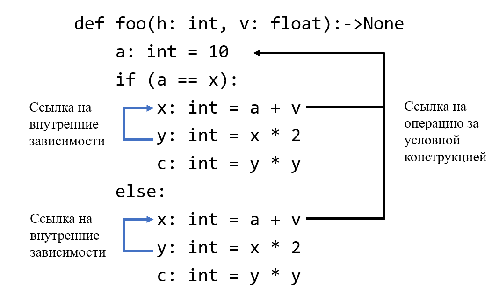

# Объединение одинаковых условных конструкций

Объединение одинаковых условных конструкций – оптимизация в
компиляторах, уменьшающая количество исходного кода, путем объединения
одинаковых блоков в условных переходах.

Оптимизация запускается на операциях условных переходов (IfOp) с
then-else ветками. Попарно сравниваем операции в then и else ветках и
если они все одинаковые, то можем объединить ветки условных переходов и
убрать условие. Главной сложностью данной оптимизации является сравнение
операций, нам необходимо понять, что совпадают все составляющие
операций.

Подробнее опишем алгоритм сравнения операций.

Операция состоит из следующих компонент:

1.  Имя.
2.  Идентификатор.
3.  Атрибуты.
4.  Внутренние атрибуты.
5.  Возвращаемые результаты.
6.  Тело.
7.  Операнды

Сравнение имен, идентификаторов и атрибутов достаточно тривиально,
сводится к сравнению строк или целочисленных типов. Для сравнения
внутренних атрибутов и возвращаемых результатов достаточно проверить,
что совпадают типы хранимых значений.

Для сравнения тел операций необходимо попарно сравнить потомков
операции.

Для сравнения операндов необходимо:

1.  Сравнить типы операнды, они должны быть одинаковыми.
2.  Сравнить владельцев операндов. Необходимо рассмотреть два случая:
    1.  Операнды ссылаются на одного и того же владельца. В этом случае
        сразу можно сказать, что операнды совпадают.
    2.  Операнды имеют разных владельцев. Тогда пытаемся сравнить
        владельцев без сравнения их тел.

При рассмотрении равенства владельцев операндов первый случай
соответствует использованию результата операции, лежащей выше (вне)
условной конструкции. Второй случай соответствует сравнению локальных
операций в условных блоках.

Иллюстрация внешних и внутренних ссылок:

На представленном рисунке:

- Черным цветом отмечены зависимости на общую операцию.
- Синим цветом отмечены внутренние зависимости.

[_Назад_](README.md)
