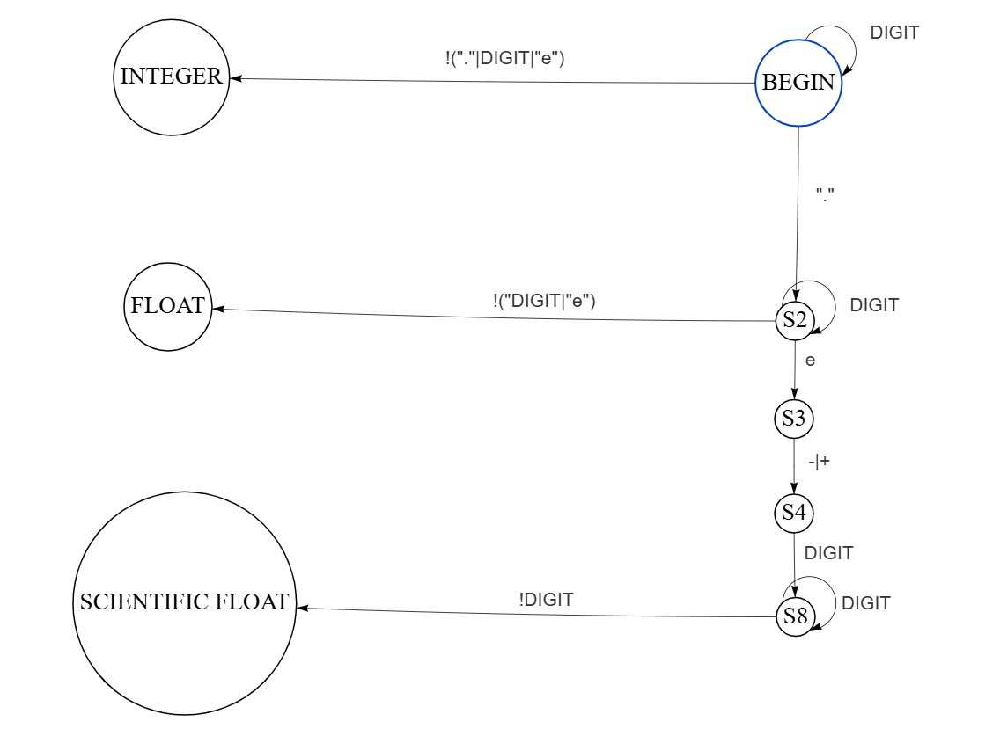

# Работа анализатора

Программа анализируется построчно.
Каждая строка программы разбивается на токены следующих типов:

* ключевые слова; 
* операторы;
* идентификаторы – имена переменных и функций;
* числовые литералы – последовательность символов, состоящая из цифр;
* строковые литералы – последовательность символов, заключенных в двойные кавычки;
* специальные – набор лексем, необходимых только для составления синтаксических деревьев.

Под токеном понимается структура данных, содержащая два поля:

* тип токена – пометка, необходимая для дальнейших стадий анализа;
* атрибут – значение.

Для формального описания анализаторов составим контекстно-свободную
грамматику. Грамматика состоит из наборов:

- Набор терминалов -- атомарные символы языка.

- Набор нетерминалов -- последовательность терминалов и нетерминалов,
  представляющая конструкции языка.

- Набор правил подстановки, задающих компонентный состав конструкций.
  Каждое правило подстановки имеет левую и правую части, разделяемые
  символом «может быть». В левой части находится нетерминал, в правой
  части -- строка из набора терминалов и нетерминалов.

Понятие контекстно-свободной грамматики не зависит от нотации, которая
используется для ее записи. Обычно такие нотации называют метаязыками
(метаязык -- язык для описания другого языка). В качестве метаязыка
выберем расширенную форму Бэкуса-Наура.

## Обнаружение токенов

### Ключевые слова

Ключевые слова -- это строго определенные последовательности символов --
букв английского алфавита, которые служат для маркировки различных
языковых конструкций, например, условных выражений.

Правило описания для ключевых слов можно представить в общем виде:

```
{Key_Name}_Word = "Key_Name"
```

Key_Name -- непосредственно, имя ключевого слова (например, int, float,
while). Например, для ключевого слова while получим следующие правило:

```
While_Word = "while"
```

### Идентификаторы

Идентификаторы -- это последовательности терминальных символов, которые
служат для объявления и определения имен переменных и функций.

Опишем правила для идентификаторов (имен переменных и функций). Правила
именования состоят в следующем:

1.  идентификатор обязан состоять из одного или более символов;

2.  идентификатор может состоять только из заглавных и строчных букв
    английского алфавита (A -- Z, a -- z), цифр от 0 до 9, знака нижнего
    подчеркивания \_;

3.  идентификатор не может иметь первым символом цифру от 0 до 9 (то
    есть, не может начинаться с цифры);

4.  идентификатор не может полностью совпадать с любым из ключевых слов
    языка.

Правило для идентификаторов:

```
Identifier = (_a-zA-Z){_a-zA-Z0-9}
```

Выражение `(_a-zA-Z)` означает, что идентификатор начинается с одного из
заданных в скобках терминала и содержит хотя бы один из ниx. Кроме
этого, исключается возможность наличия цифр в начале идентификатора.
Таким образом, идентификатор уже удовлетворяет 1, 2, и 3 правилам
именования.

Выражение `{_a-zA-Z0-9}` означает, что идентификатор далее содержит
указанные символы в любом их количестве.

Если идентификатор будет совпадать с одном из ключевых слов, то будет
получена ошибка на этапе анализа синтаксиса полученных токенов.

### Целочисленные и дробные литералы

Целочисленные литералы записываются с помощью набора символов: цифр от 0
до 9 без пробелов. Дробные значения с плавающей точкой записываются в
виде десятичных дробей аналогично целым числам, для разделения целой и
дробной части используется символ «точка». Так же дробные литералы могут
быть записаны при помощи экспоненциальной записи.

Введем дополнительный нетерминал `DIGIT` и опишем правила для литералов.

```
DIGIT = (0-9)
IntegerLiteral = DIGIT{DIGIT}
FloatLiteral = DIGIT{DIGIT}.DIGIT{DIGIT}|DIGIT{DIGIT}(.){DIGIT}e(-|+)DIGIT{DIGIT}
```

Для целочисленных литералов используются две записи. Символ `|`,
разделяет записи в виде десятичной дроби и экспоненциальной, означая,
что может встретиться одна из них.



В приведенном языке знак перед числовыми литералами в лексическом
анализаторе не учитывается (оператор «минус» учитывается, как отдельный
оператор и отрицательным число станет во время построения дерева
разбора). Такой вариант упрощает работу с выражениями в лексическом
анализаторе, так как если вводить правила, которые учитывают знак сразу,
то необходимо будет добавлять дополнительные токены в зависимости от
контекста операции, что фактически заставит на этапе лексического
разбора выполнить синтаксический анализ выражений. Поэтому проще учесть
знак на следующей стадии.

Например, при анализе выражения `3 - 4` получим следующий список
токенов `{IntegerLiteral, "3"}, {Operator, "-"}, {IntegerLiteral,
"4"}`.

Если учитывать знак, то получим `{IntegerLiteral, "3"},
{IntegerLiteral, "-4"}`.

Для синтаксического анализатора необходимо будет учитывать знак при
просмотре операций или искусственно добавлять операцию плюс, что
усложнит и правила, и алгоритмы для анализа. В текущей реализации
оператор минус учитывается в зависимости от контекста:

1.  Как бинарный. Когда в контексте можно выделить двух кандидатов на
    роль операндов. Например, для строчки

    ```python
    X: int = 3 - 4
    ```

2.  Как унарный. Когда оператор минус обособлен или не удается найти
    второго кандидата. Например, для кода

    ```python
    X: int = -3 - 4
    Y: int = -4
    Z: int = -foo(-a)
    ```

В этих примерах, только один оператор минус является бинарным (`3 - 4`,
нашлось два кандидата). Под обособленностью понимаем отделение скобками.

### Операторы

Правила для операторов описываются аналогично ключевым словам. Правила
для специальных лексем, следующие:

```
Indentation = "  "
EndOfExpression = [\n]
```

Для `Indentation` в кавычках ищем строку из 4 пробелов.

## Принцип работы

Опишем работу лексического анализатора.

Изначально для каждой поступающей строки производится выделение отступов
и формирование соответствующих им токенов с учетом правил языка (каждый
отступ должен содержать в себе 4 пробела). Далее создаются два
итератора, соответствующие началу и концу анализируемой подстроки. В
зависимости от содержащихся в ней символов выполняется одна из процедур
для создания токенов:

- Создание токенов для ключевых слов и идентификаторов. Если подстрока
  состоит только из букв, то выполняется проверка, не является ли она
  одним из ключевых слов языка, в противном случае подстрока будет
  считаться идентификатором.

- Создание токенов для числовых литералов. Если подстрока начинается с
  цифры, то продолжаем сдвигать итератор до тех пор, пока нам не
  попадётся символ отличный от цифры. Исключение составляет символ
  `.`, если был встречен такой символ, то продолжаем считывать
  цифры, стоящие после нее. Таким образом, при встрече символа `.`
  формируются числовые литералы с плавающей точкой, а иначе
  целочисленные литералы.

- Создание токенов для строковых литералов. Если подстрока начинается с
  `"`, то продолжаем сдвигать итератор до тех пор, пока нам не попадётся
  следующая `"`. Символы, заключенные между кавычками, будем считать
  строковым литералом.

- Создание токенов для операторов и специальных символов. Если при
  анализе был встречен один из символов, относящихся к операторам или
  специальным символам, то будет создан токен соответствующего типа
  оператора. Анализатор формирует токены операторов максимальной длины,
  то есть, если были встречены символы `!`, `=`, `<`, `>`, то
  необходимо посмотреть, не следует ли за ними символ `=`, в зависимости
  от этого будут формироваться различные токены.

Стоит отметить, что лексический анализатор не проверяет осмысленность последовательности токенов, то есть строка `a 1.0 if b +` будет являться абсолютно корректной. 

[_Назад_](README.md)
