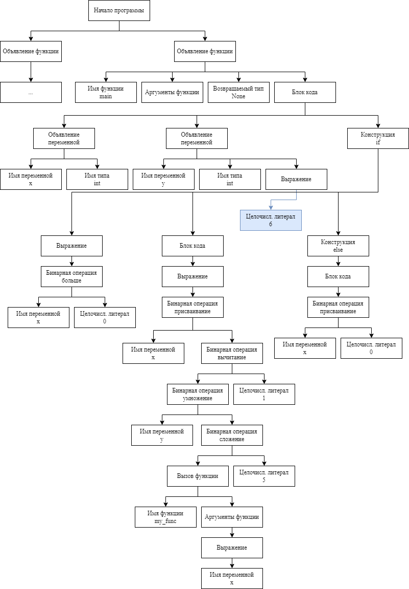

# Пример работы анализатора

Допустим, имеется следующий код:

```python
def my_func(int: x) -> int:
    return x + 1
```

При корректной реализации предыдущих этапов (в особенности, лексического
анализа) синтаксический анализатор должен получить на вход следующий
список токенов:

| Ключевое слово | → | Иденти- фикатор | → | Оператор | → | Иденти- фикатор | → | Спец. послед-ть | → |
|:--:|:--:|:--:|:--:|:--:|:--:|:--:|:--:|:--:|:--:|
| def |  | my_func |  | ( |  | int |  | : |  |

| Оператор | → | Спец. послед-ть | → | Иденти- фикатор | → | Спец. послед-ть | → | Спец. послед-ть | → |
|:--:|:--:|:--:|:--:|:--:|:--:|:--:|:--:|:--:|:--:|
| ) |  | -\> |  | int |  | : |  | *перенос строки* |  |

| Спец. послед-ть | → | Ключевое слово | → | Иденти- фикатор | → | Оператор | → | Целочисл. литерал | ∅ |
|:--:|:--:|:--:|:--:|:--:|:--:|:--:|:--:|:--:|:--:|
| *отступ* |  | return |  | x |  | \+ |  | 1 |  |


Далее, дополним приведенный код следующим фрагментом:

```python
def main() -> None:
    x: int
    y: int = 6
    if x > 0:
        x = y * (my_func(x) + 5) - 1
    else:
        x = 0
```

Теперь, когда код стал более содержательным, при условии, что список
токенов для него также был сгенерирован корректно, в качестве выхода
синтаксического анализатора должно получиться синтаксическое дерево,
приведенное на рисунке.



Примеры, данные в этом разделе, можно считать показательными в том
смысле, что они охватывают практически все используемые в реализации
типы (рода содержимого) как токенов, так и узлов дерева. Не было уделено
внимание лишь узлам «конструкция elif» и «конструкция while», но их
структура схожа с узлами «конструкция if».

Как видно, синтаксическое дерево не является бинарным, так как многие
типы узлов предполагают наличие более двух потомков.

[_Назад_](README.md)
