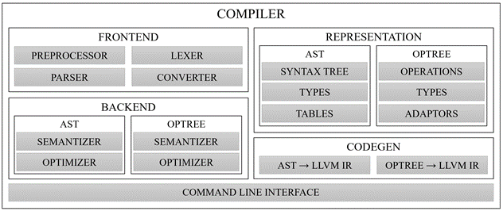

# Архитектура продукта

Общая схема работы готового продукта «Компилятор» выглядит следующим образом: консольное приложение запускает внутри себя компоненты содержательных модулей, представленных на рисунке ниже.
В процессе анализируется файл исходного кода, строится синтаксическое дерево и другие промежуточные представления программы, и генерируется код на языке LLVM IR.
Полученный файл может быть транслирован в объектный с помощью утилиты LLCompiler (llc) и в дальнейшем может быть использован компоновщиком для получения исполняемого файла.

На рисунке в виде блоков представлены следующие компоненты:

- Frontend – обработка текста программы:
  - Preprocessor – препроцессор;
  - Lexer – лексер (лексический анализатор);
  - Parser – парсер (синтаксический анализатор);
- Backend – анализ промежуточных представлений:
  - AST – модули, работающие с абстрактным синтаксическим деревом:
    - Semantizer – модуль, проверяющий семантическую корректность построенного AST;
    - Optimizer – оптимизирующий анализатор для синтаксических деревьев;
  - Optree – модули, работающие с деревом операций:
    - Semantizer – модуль, проверяющий семантическую корректность построенного дерева операций;
    - Optimizer – оптимизирующий анализатор для дерева операций;
- Representation – структуры для работы с представлениями кода:
  - AST – инструменты для работы с синтаксическим деревом:
    - Syntax tree – структуры данных;
    - Types – вспомогательные структуры для идентификации типов;
    - Tables – структуры данных для хранения таблиц символов;
  - Optree – инструменты для работы с деревом операций:
    - Operations – описание операции;
    - Types – система типов значений операций;
    - Adaptors – классы-адаптеры для операций.
- Codegen – генераторы LLVM IR для разных представлений:
  - AST в IR – модуль для перевода синтаксического дерева;
  - Optree в IR – модуль для перевода дерева операций;
- Command line interface – консольное приложение.

Для обеспечения корректности работы был разработан комплект функциональных и интеграционных тестов для компонентов проекта.

Компилятор работает с Python-подобным статически типизированным языком, в котором присутствуют основные языковые конструкции (объявления функций и переменных, условия, циклы, вызовы функций, вычисление арифметико-логических выражений), возможность вывода текста на экран и считывания данных с клавиатуры.

[_Назад_](README.md)
