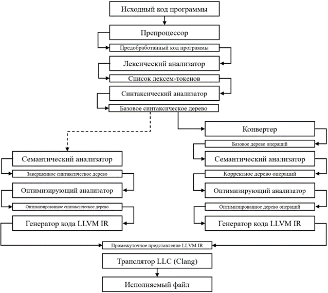

# Этапы работы компилятора

В предлагаемой реализации компиляция кода должна осуществляться в несколько этапов.
За каждый из этапов отвечает один из представленных в рамках проекта модулей, взаимодействующих подобно конвейеру: выходные данные одного этапа являются входными для следующего, как это видно на рисунке.

В начальной версии проекта анализ компилируемой программы производился с использованием синтаксического дерева, что отражено в левой части схемы.
Позднее ему на смену пришло другое промежуточное представление -- дерево операций, этапы анализа которого представлены справа.

Исходный код программы передаётся на вход препроцессору, где происходит
удаление лишних символов, которые не нужны в дальнейшем анализе
(комментарии, лишние пробелы, и переносы строк). Далее поток символов
передается лексическому анализатору, где формируется список токенов, на
основе которого в синтактическом анализаторе будет построено абстрактное
синтаксическое дерево. После этого происходит стадия проверки семантики
языка (проверка типов, названий переменных и др.) и генерация
промежуточных представлений и машинного кода. Во время работы
анализаторов могут быть обнаружены ошибки в исходном коде программы,
компилятор должен уведомить пользователя об их нахождении. Многие
компиляторы поддерживают различные оптимизации языка, которые могут
производиться как над синтаксическими деревьями, так и над промежуточным
представлением и машинным кодом. Стадии анализа часто называют front-end
частью компилятора, а все дальнейшие back-end.

[_Назад_](README.md)
