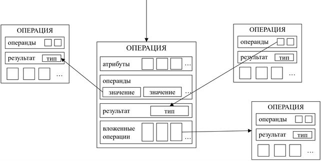

# Описание дерева операций

Дерево операций – это дополнительное промежуточное представление
исходной программы. В общем случае узлами дерева являются операции,
которые обмениваются между собой значениями, каждое из которых
определяется своим типом .

Как видно на рисунке, операция может иметь
произвольное число операндов, не более одного результата, произвольное
число атрибутов (вспомогательных данных, независимых от других
операций), произвольное число вложенных операций внутри, а также
объемлющую операцию, в теле которой указанная операция и находится.

**Операция** владеет внешними значениями (результатами) и внутренними
регистрами. Результаты видны соседям операции и могут быть операндами
других операций, но не видны операциям внутри тела. Внутренние регистры,
наоборот, доступны для использования операциями внутри тела, но снаружи
не видны (как переменные во вложенном блоке в C++). Операция не владеет
операндами, так как это результаты или внутренние регистры других
операций. Также внутри хранится имя операции и код, определяющий ее вид.

**Значение** – это единоразово определяемый неизменяемый регистр (как
const переменная в C++). Значение нельзя "изменить", но можно
создать новую операцию, которая будет иметь нужное значение в качестве
результата, а старое значение отбросить (при необходимости удалить
порождающую его операцию из дерева). Значение хранит внутри себя
породившую операцию, тип, список использований (операций, среди
операндов которых есть указанное значение).

**Тип** – это характеристика представления значения; неизменяемая
структура, содержащая информацию, полезную для, собственно,
представляемого типа. Система типов в дереве операций сходна с системой
типов компилируемого языка.

**Атрибут** – это вспомогательные данные, которые используются для
анализа операции (какое-либо численное значение, тип, подвид операции,
строка и так далее). Например, операция, описывающая функцию, может
иметь имя функции и тип в качестве атрибутов, а операция, описывающая
объявление константы – значение и тип константы и т. д.

К особенностям дерева операций можно отнести следующее:

- Дерево операций можно построить из синтаксического дерева за один
  проход.

- Анализ использования значения представляет собой обход готового
  списка.

- Добавление или изменение операций прозрачно: операция хранит
  информацию о своем положении в дереве, значение хранит информацию о
  связанной операции и типе.

- Невозможно восстановить текст исходной программы напрямую, но можно
  ссылаться на исходный код в диагностике для пользователя, если
  сохранить ссылки на места в коде внутри операций при их создании из
  узлов синтаксического дерева.

[_Назад_](README.md)
